# 计算机系统导论（下）上机实验一：链接 实验报告

- **课程名称**：计算机系统导论（下）
- **实验名称**：上机实验一：链接 (Linking)
- **学生姓名**：Ariestar
- **实验环境**：Ubuntu 24.04 LTS (x86_64), GCC 13+, Binutils (nm, readelf, objdump, ar)
- **文档产物**：[Word 版实验报告](计算机系统导论_实验一_链接_实验报告.docx) | [源代码与工程工程](.)

---

## 目录

- [一、实验目的与背景](#一实验目的与背景)
- [二、基础实验1：观察目标文件、符号表与 ELF 结构](#二基础实验1观察目标文件符号表与-elf-结构)
  - [1. 实验代码准备](#1-实验代码准备)
  - [2. 编译生成可重定位目标文件](#2-编译生成可重定位目标文件)
  - [3. nm 工具查看符号表与符号解析分析](#3-nm-工具查看符号表与符号解析分析)
  - [4. readelf -S 查看节头表（Section Headers）](#4-readelf--s-查看节头表section-headers)
  - [5. objdump -d -r 反汇编与重定位条目解析](#5-objdump--d--r-反汇编与重定位条目解析)
- [三、基础实验2：重定位算法推导与验证](#三基础实验2重定位算法推导与验证)
  - [1. 重定位算法原理（教材图 7.10）](#1-重定位算法原理教材图-710)
  - [2. 提取重定位条目与符号地址](#2-提取重定位条目与符号地址)
  - [3. 编译生成可执行文件与符号地址确认](#3-编译生成可执行文件与符号地址确认)
  - [4. 手动重定位计算推导与精确验算](#4-手动重定位计算推导与精确验算)
- [四、基础实验3：静态链接与动态链接](#四基础实验3静态链接与动态链接)
  - [1. 静态库实验（教材图 7.6 ~ 7.8）](#1-静态库实验教材图-76--78)
  - [2. 动态加载和链接共享库实验（教材图 7.17）](#2-动态加载和链接共享库实验教材图-717)
  - [3. ldd 工具对比分析](#3-ldd-工具对比分析)
- [五、进阶实验4：实现简易静态库打包工具 mylib（选做）](#五进阶实验4实现简易静态库打包工具-mylib选做)
  - [1. 设计目标与规范](#1-设计目标与规范)
  - [2. 编译与模块结构](#2-编译与模块结构)
  - [3. 打包生成静态库与符号索引构建](#3-打包生成静态库与符号索引构建)
  - [4. 库成员列表 (-t) 与符号索引查看 (-s)](#4-库成员列表--t-与符号索引查看--s)
  - [5. 提取指定目标文件 (-x)](#5-提取指定目标文件--x)
  - [6. 与 GNU 官方工具链完全兼容性验证](#6-与-gnu-官方工具链完全兼容性验证)
- [六、实验总结与心得体会](#六实验总结与心得体会)

---

## 一、实验目的与背景

链接（Linking）是将各种代码和数据片段收集并组合成为一个单一文件的过程，这个文件可被加载（复制）到内存并执行。链接可以执行于编译时（compile time）、加载时（load time）以及运行时（run time）。理解链接器的工作机制对于构造大型程序、避免难以排查的运行时错误、理解变量与函数的作用域以及共享库动态加载机制具有核心意义。

本次实验对应《深入理解计算机系统》（CS:APP 3e）第七章“链接”，通过系统实践深入探究以下核心内容：
1. 观察并分析可重定位目标文件（ELF 格式）的节区结构、符号表及重定位条目。
2. 掌握重定位的核心算法，基于重定位条目与符号地址手动推导重定位修补值，并与编译器生成的实际指令进行完全验算。
3. 掌握静态库的构建与按需链接机制，以及基于 `dlopen`/`dlsym` 的共享库运行时动态加载机制。
4. （进阶选做）自主设计并实现简易静态库打包工具 `mylib`，深入底层解析 ELF 符号表并生成符合工业标准的归档索引表。

---

## 二、基础实验1：观察目标文件、符号表与 ELF 结构

### 1. 实验代码准备

按照教材图 7.1，编写两个 C 语言源文件 `main.c` 与 `sum.c`：
- `main.c`：定义全局已初始化数组 `array[2] = {1, 2}`，在 `main` 函数中调用外部函数 `sum(array, 2)` 并返回求和结果。
- `sum.c`：实现 `sum` 函数，遍历数组并累加元素求和。

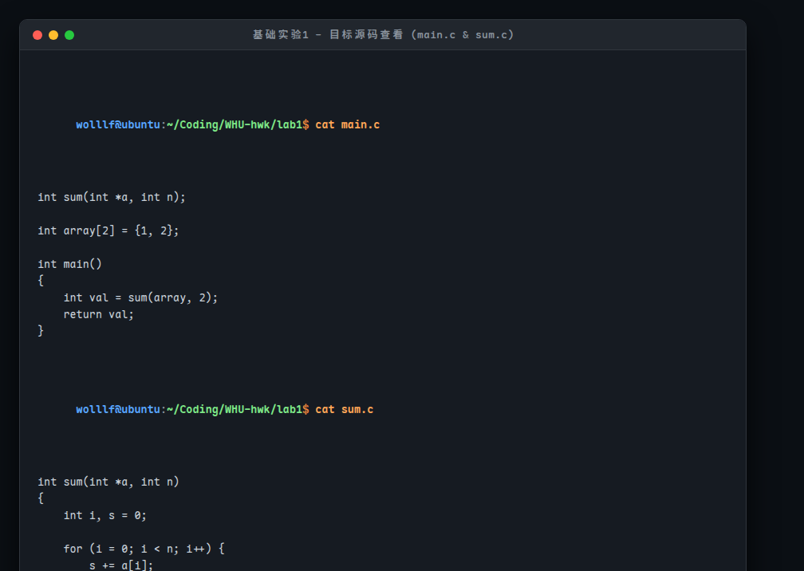

### 2. 编译生成可重定位目标文件

使用 `gcc -Og -Wall -c main.c sum.c` 分别编译生成可重定位目标文件 `main.o` 和 `sum.o`：

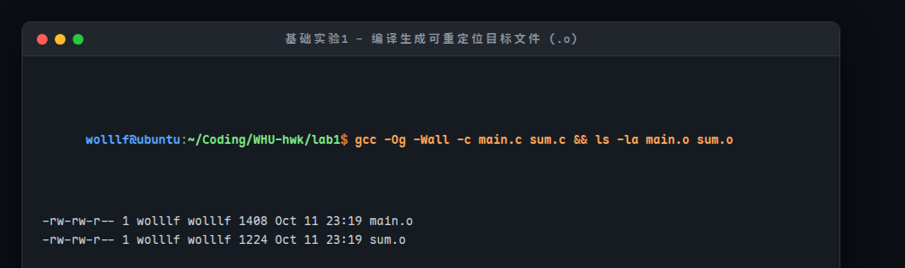

### 3. nm 工具查看符号表与符号解析分析

执行 `nm main.o sum.o` 观察两个模块的符号表：

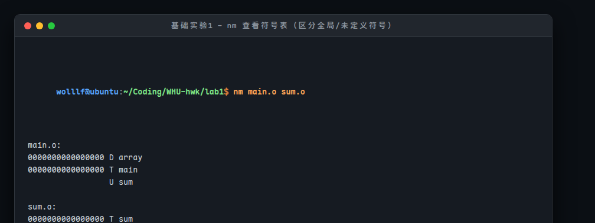

**符号表输出分析**：
- `main.o` 中的 `array`：类型标识为 **`D`**，表示该符号是已初始化的全局数据变量（位于 `.data` 节），在 `main.o` 中被定义。
- `main.o` 中的 `main`：类型标识为 **`T`**，表示全局函数代码符号（位于 `.text` 节），在 `main.o` 中被定义。
- `main.o` 中的 `sum`：类型标识为 **`U`**，表示 Undefined（未定义外部符号）。`main.c` 仅声明了 `sum` 但未在此模块中定义，必须由链接器在后续链接阶段从其他模块（`sum.o`）中进行符号解析解析定位。
- `sum.o` 中的 `sum`：类型标识为 **`T`**，表示全局函数代码符号，为外部模块提供了符号定义。

### 4. readelf -S 查看节头表（Section Headers）

执行 `readelf -S main.o` 观察 ELF 节区结构与属性：

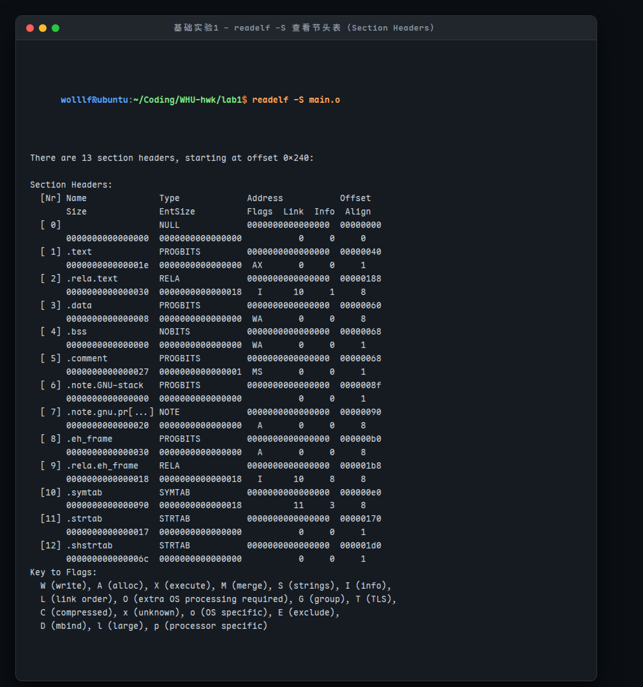

**核心节区说明**：
1. `.text` (`PROGBITS`, `AX`)：存放已编译的机器代码指令。Flags 为 `AX` (Allocated + Executable)，表示程序运行时需要分配内存且具有可执行权限。
2. `.data` (`PROGBITS`, `WA`)：存放已初始化的全局变量（如 `array[2]`）。Flags 为 `WA` (Writable + Allocated)，具有读写与内存分配权限。
3. `.bss` (`NOBITS`, `WA`)：存放未初始化的全局/静态变量。在目标文件中不占用实际磁盘空间（`NOBITS`），仅在运行时占内存。
4. `.symtab` (`SYMTAB`)：符号表，记录程序中定义和引用的所有函数与全局变量信息。
5. `.strtab` (`STRTAB`)：字符串表，存放符号名和节名对应的具体字符串文本。
6. `.rela.text` (`RELA`, `I`)：包含 `.text` 节的重定位条目列表。链接器将各目标文件合并时，利用该节的信息修补代码中的外部引用。

### 5. objdump -d -r 反汇编与重定位条目解析

执行 `objdump -d -r main.o` 对 `main.o` 进行反汇编并同步显示关联的重定位条目：

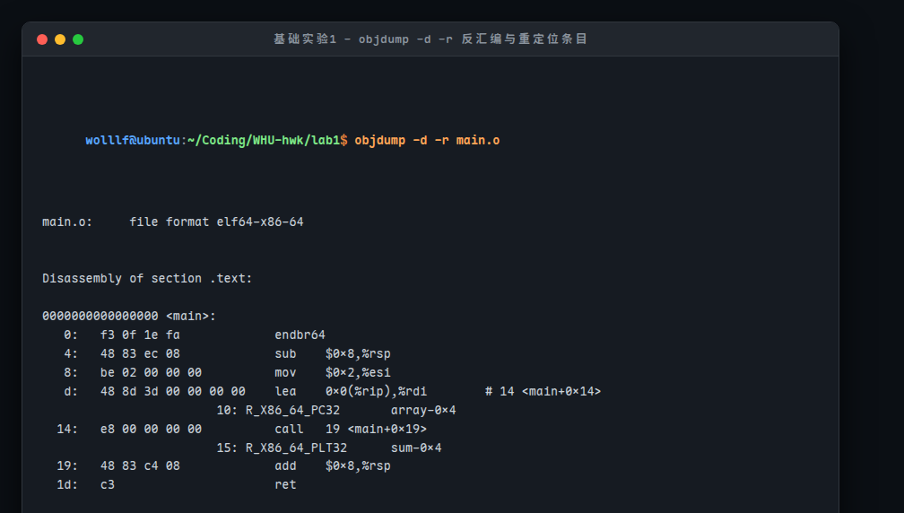

**反汇编指令与重定位标记分析**：
- 偏移 `0xd` 处的指令：`lea 0x0(%rip), %rdi`，机器码为 `48 8d 3d 00 00 00 00`。紧随其后的偏移 `0x10` 处标记了重定位条目 `R_X86_64_PC32 array-0x4`。因为编译时 `array` 的实际虚拟地址未知，编译器在此处暂时填入 `00 00 00 00` 占位，并指示链接器在链接时修补该 4 字节偏移。
- 偏移 `0x14` 处的指令：`call 19 <main+0x19>`，机器码为 `e8 00 00 00 00`。紧随其后的偏移 `0x15` 处标记了重定位条目 `R_X86_64_PLT32 sum-0x4`。同样，`sum` 的目标跳转地址在编译时未知，编译器用 `00 00 00 00` 占位，留待链接器计算并填入正确的相对偏移量。

---

## 三、基础实验2：重定位算法推导与验证

### 1. 重定位算法原理（教材图 7.10）

链接器在符号解析完成后执行重定位（Relocation）：首先将所有输入目标文件中的同类型节合并为一个大节，并为每个节和符号分配运行时虚拟地址；随后依据重定位条目修改代码节和数据节中所有对符号的引用。

ELF 64 位标准重定位条目结构为 `Elf64_Rela`，包含：
- `r.offset`：需要被修改的引用在当前节中的字节偏移量。
- `r.symbol`：被引用的符号。
- `r.type`：重定位类型（如 PC 相对寻址 `R_X86_64_PC32` 或绝对寻址 `R_X86_64_32`）。
- `r.addend`：符号偏移调整量（加数）。

根据 CS:APP 图 7.10，重定位计算算法如下：
```c
foreach section s {
    foreach relocation entry r {
        refptr = s + r.offset; /* 指向需要修补的 4 字节位置 */

        /* 重定位 PC 相对引用 */
        if (r.type == R_X86_64_PC32 || r.type == R_X86_64_PLT32) {
            refaddr = ADDR(s) + r.offset; /* 引用的运行时虚拟地址 */
            *refptr = (unsigned) (ADDR(r.symbol) + r.addend - refaddr);
        }

        /* 重定位绝对引用 */
        if (r.type == R_X86_64_32) {
            *refptr = (unsigned) (ADDR(r.symbol) + r.addend);
        }
    }
}
```

### 2. 提取重定位条目与符号地址

使用 `readelf -r main.o` 和 `objdump -dx main.o` 提取重定位条目信息：

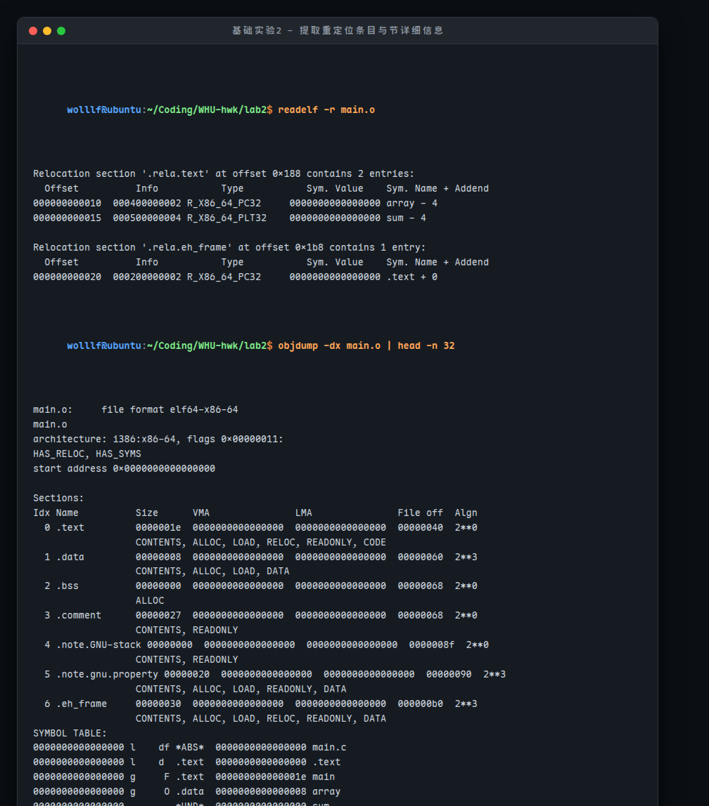

重定位条目明细：
- 条目 1 (`array`)：`offset = 0x10`, `type = R_X86_64_PC32`, `symbol = array`, `addend = -4 (-0x4)`。
- 条目 2 (`sum`)：`offset = 0x15`, `type = R_X86_64_PLT32`, `symbol = sum`, `addend = -4 (-0x4)`。

### 3. 编译生成可执行文件与符号地址确认

编译生成可执行文件 `prog`（默认 PIE）以及 `prog_nopie`（指定 `-no-pie`）：

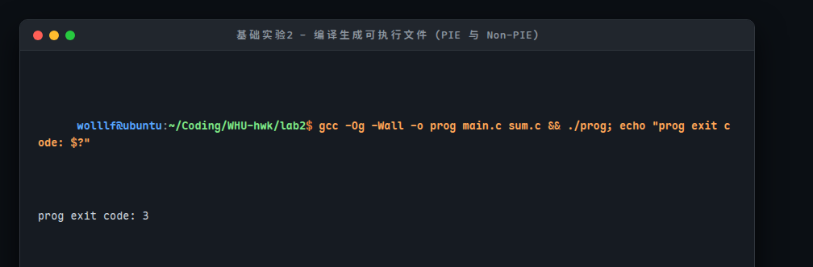

通过 `objdump -d` 反汇编观察链接器合并节区并完成重定位修补后的可执行文件：

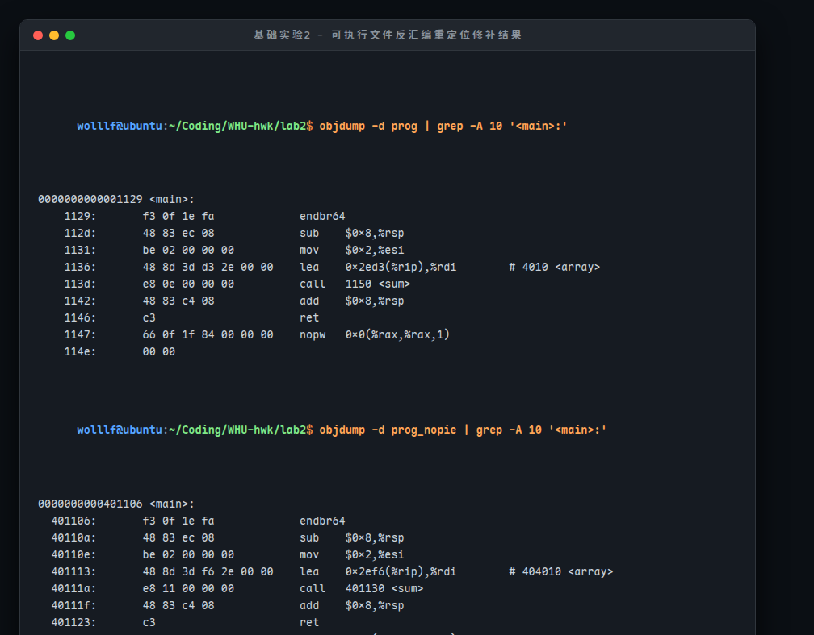

### 4. 手动重定位计算推导与精确验算

#### 【推导验证 1：PIE 模式可执行文件 prog】
在 `prog` 中，符号分配的运行时虚拟基地址为：
- `ADDR(main) = 0x1129`
- `ADDR(sum) = 0x1150`
- `ADDR(array) = 0x4010`

**(1) 对 array 符号的 PC 相对重定位**：
- 引用在 `main` 中的偏移为 `0x10`，因此 `refaddr = ADDR(main) + 0x10 = 0x1129 + 0x10 = 0x1139`；
- `r.addend = -4`；
- 代入公式：
  $$\text{*refptr} = \text{ADDR}(\text{array}) + \text{r.addend} - \text{refaddr} = 0\text{x}4010 + (-4) - 0\text{x}1139 = 0\text{x}400C - 0\text{x}1139 = 0\text{x}2ED3$$
- 反汇编指令为：`1136: 48 8d 3d d3 2e 00 00 (lea 0x2ed3(%rip), %rdi)`。机器码偏移字段为 `d3 2e 00 00`（小端序 `0x00002ed3`），与手动推导完全一致！
- 寻址验证：下一条指令地址 (`0x113d`) + `0x2ed3` = `0x4010` = `ADDR(array)`，精准命中 `array`！

**(2) 对 sum 符号的 PC 相对重定位**：
- 引用在 `main` 中的偏移为 `0x15`，因此 `refaddr = ADDR(main) + 0x15 = 0x1129 + 0x15 = 0x113E`；
- `r.addend = -4`；
- 代入公式：
  $$\text{*refptr} = \text{ADDR}(\text{sum}) + \text{r.addend} - \text{refaddr} = 0\text{x}1150 + (-4) - 0\text{x}113E = 0\text{x}114C - 0\text{x}113E = 0\text{x}0E$$
- 反汇编指令为：`113d: e8 0e 00 00 00 (call 1150 <sum>)`。机器码偏移字段为 `0e 00 00 00`（小端序 `0x0e`），与手动推导完全一致！
- 寻址验证：`call` 指令下一条指令地址 (`0x1142`) + `0x0e` = `0x1150` = `ADDR(sum)`，精准跳转至 `sum` 入口！

#### 【推导验证 2：非 PIE 模式可执行文件 prog_nopie】
在 `prog_nopie` 中，符号基地址分配为经典静态地址空间：
- `ADDR(main) = 0x401106`, `ADDR(sum) = 0x401130`, `ADDR(array) = 0x404010`。
- `array` 处 `refaddr = 0x401106 + 0x10 = 0x401116`。计算值 = `0x404010 - 4 - 0x401116 = 0x2EF6`。
  指令机器码：`48 8d 3d f6 2e 00 00`，完全一致！
- `sum` 处 `refaddr = 0x401106 + 0x15 = 0x40111B`。计算值 = `0x401130 - 4 - 0x40111B = 0x11`。
  指令机器码：`e8 11 00 00 00`，完全一致！

编写自动化验算脚本 `lab2/calc.py` 对上述全部用例进行计算，所有用例均通过：

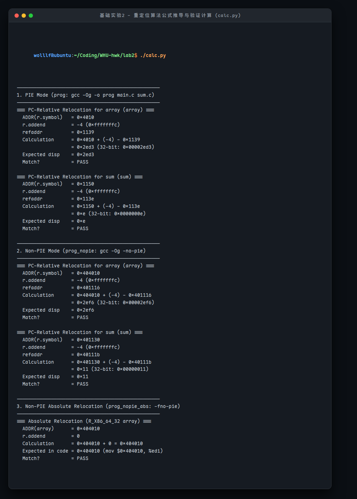

---

## 四、基础实验3：静态链接与动态链接

### 1. 静态库实验（教材图 7.6 ~ 7.8）

静态库（Archive 文件，以 `.a` 为后缀）是将多个可重定位目标文件打包在一起的集合。链接时，链接器仅复制被应用程序引用的目标模块，极大节约了可执行文件的空间。

实验步骤：
1. 编写向量加法 `addvec.c`、向量乘法 `multvec.c` 以及接口头文件 `vector.h`；
2. 编译目标文件并使用 `ar` 工具打包：`ar rcs libvector.a addvec.o multvec.o`；
3. 使用 `ar -t` 查看库内成员文件，使用 `nm` 查看库中包含的所有符号。

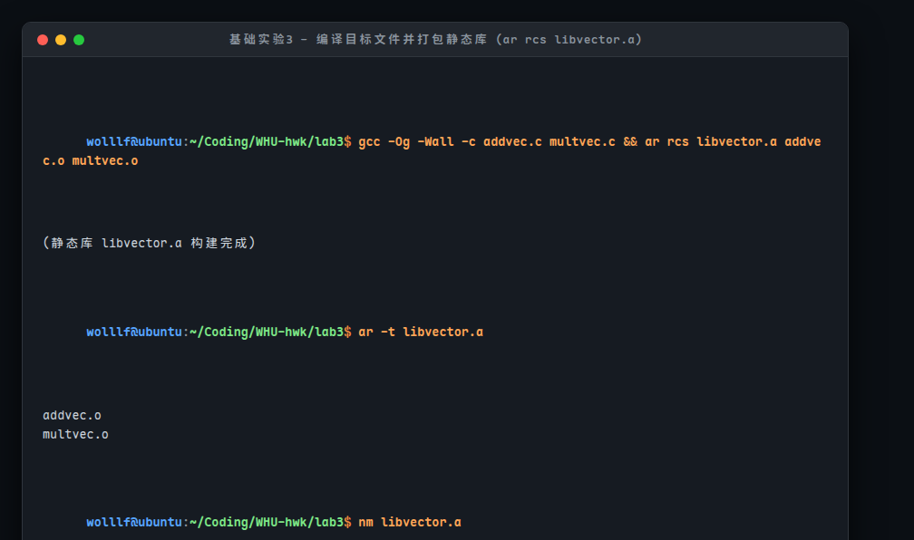

编写主程序 `main2.c`（仅调用了 `addvec`），并执行静态链接：
```bash
gcc -c main2.c
gcc -static -o prog2c main2.o ./libvector.a
./prog2c
# 输出: z = [4 6]
```

**静态库符号按需解析验证**：
执行 `nm prog2c | grep -E 'addvec|multvec'`，发现输出中仅包含 `addvec` 和 `addcnt`，而 `multvec` 和 `multcnt` 完全不存在。这证明了链接器对静态库的处理原则：从左至右扫描，只拷贝真正被引用的目标文件（`addvec.o`），未被引用的文件（`multvec.o`）被直接丢弃，不占用最终可执行文件体积。

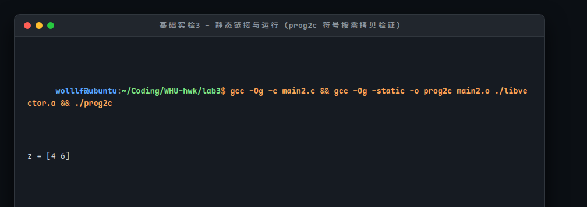

### 2. 动态加载和链接共享库实验（教材图 7.17）

共享库（Shared Library，在 Linux 下为 `.so` 文件）支持在运行时由应用程序显式加载并动态链接，无需在编译期将库绑定到可执行文件中。Linux 提供了动态链接加载器接口：
- `dlopen()`：打开并加载指定的共享库文件；
- `dlsym()`：根据符号名称字符串查找函数或变量的虚拟地址；
- `dlerror()`：返回最近一次调用动态链接 API 发生的错误字符串；
- `dlclose()`：卸载共享库。

实验步骤：
1. 使用 `-shared -fpic` 选项生成位置无关代码的共享库：`gcc -shared -fpic -o libvector.so addvec.c multvec.c`；
2. 编写 `dll.c`，使用 `dlopen("./libvector.so", RTLD_LAZY)` 加载共享库，通过 `dlsym` 获取 `addvec` 函数指针并调用；
3. 编译可执行文件：`gcc -rdynamic -o prog2r dll.c -ldl`；
4. 执行 `./prog2r`，成功输出结果：`z = [4 6]`。

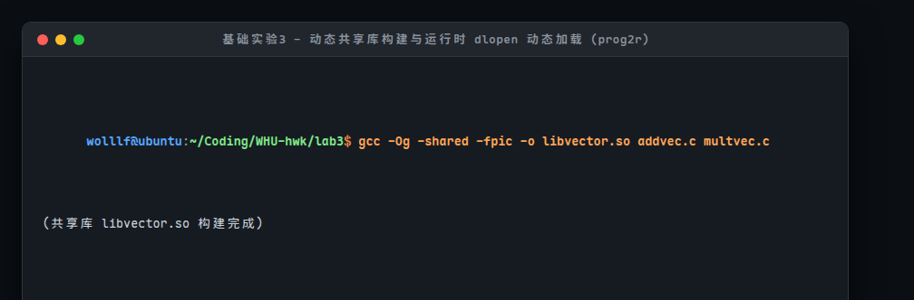

### 3. ldd 工具对比分析

使用 `ldd` 命令分别分析 `prog2c` 与 `prog2r`：
- `prog2c`：输出 `not a dynamic executable`。表明由于采用了静态链接，所有依赖库代码（包括 C 运行时库）均已固化在程序内部，运行时无需任何动态链接器支持。
- `prog2r`：显示依赖 `libc.so.6` 与 `ld-linux-x86-64.so.2`，但是依赖列表中**并无 `libvector.so`**！这证明 `libvector.so` 并非编译时强制依赖，而是在程序运行到 `dlopen` 语句时才被按需动态装载进进程地址空间，适用于插件化架构与热更新。

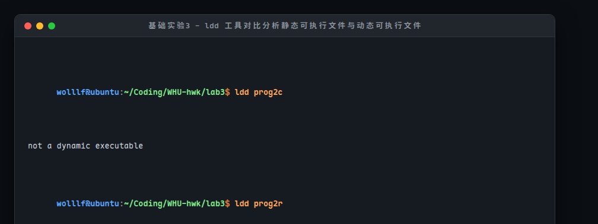

---

## 五、进阶实验4：实现简易静态库打包工具 mylib（选做）

### 1. 设计目标与规范

进阶实验要求自主实现一个 C 语言程序 `mylib`，能够遍历当前目录下的所有 `.o` 目标文件，解析其符号表并打包生成类似 `ar` 命令生成的静态库 `.a` 文件，同时生成符号索引表（ranlib 机制），并提供 `-t` 列出库成员和 `-x` 解压目标文件的功能。

**核心实现规范**：
1. **归档格式规范**：严格遵循 Unix/GNU ar 格式规范，以 8 字节魔数 `!<arch>\n` 开头，各成员文件前均包含 60 字节的 `struct ar_hdr`（文件名、修改时间、UID、GID、权限模态、文件大小及 '`\n' 结束符），保证 2 字节对齐。
2. **ELF 符号解析**：直接引入 `/usr/include/elf.h`，解析 ELF64 头部（`Elf64_Ehdr`）、节头表（`Elf64_Shdr`），定位符号表 `.symtab` 与字符串表 `.strtab`。筛选绑定属性为 `STB_GLOBAL` 或 `STB_WEAK` 且有效定义（`st_shndx != SHN_UNDEF`）的全局函数与全局变量。
3. **符号索引表生成（Ranlib 索引）**：将符号索引作为归档文件的第一个成员，成员名规范为 `/               `。索引数据区存放符号总数（大端序 `uint32_t`）、各符号所属目标文件在归档内的文件偏移量列表（大端序 `uint32_t` 数组），以及紧随其后的 null 结尾符号名称字符串池。
4. **命令行交互设计**：
   - `mylib -c <lib.a> [file.o ...]`: 打包目标文件（未指定时自动通过 `opendir` 扫描当前目录下 `*.o`）；
   - `mylib -t <lib.a>`: 列出库中所有成员、大小、权限与时间；
   - `mylib -x <lib.a> [file.o]`: 提取并解压指定目标文件；
   - `mylib -s <lib.a>`: 格式化打印符号索引表（符号名到归档文件偏移映射）。

### 2. 编译与模块结构

设计测试模块 `test1.c`（提供全局变量 `g_counter1` 与函数 `math_add`）和 `test2.c`（提供全局变量 `g_counter2` 与函数 `math_sub`），编译生成 `mylib` 工具及测试目标文件：

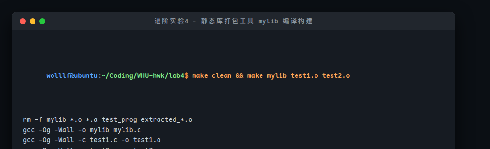

### 3. 打包生成静态库与符号索引构建

执行 `./mylib -c libtest.a test1.o test2.o`，程序自动打开 ELF 目标文件并遍历节区符号表，成功提取全部全局符号并生成包含 ranlib 符号索引的静态库 `libtest.a`：

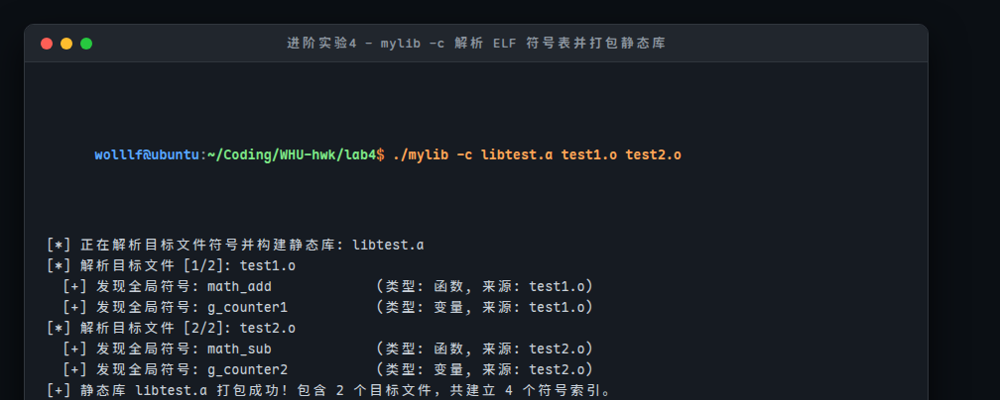

### 4. 库成员列表 (-t) 与符号索引查看 (-s)

执行 `./mylib -t libtest.a` 列出库内包含的目标文件信息，执行 `./mylib -s libtest.a` 打印详细的符号到文件偏移映射关系：

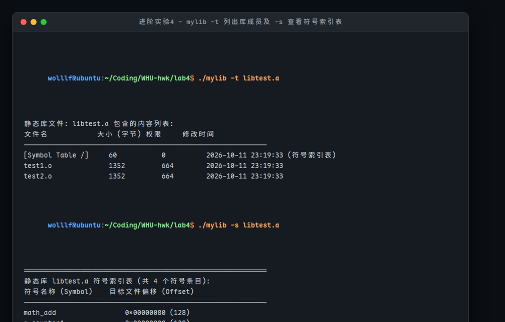

### 5. 提取指定目标文件 (-x)

先删除本地的 `test1.o`，随后执行 `./mylib -x libtest.a test1.o`。`mylib` 成功定位到库中对应成员，并将二进制数据还原写回到磁盘中：

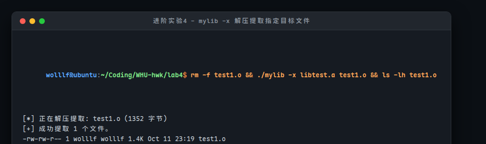

### 6. 与 GNU 官方工具链完全兼容性验证

为了严格验证 `mylib` 生成的静态库是否完全符合工业标准，直接调用系统内置的 GNU 官方工具进行交叉验证：
1. 使用官方 `ar -t libtest.a`：识别库成员，准确列出 `test1.o` 与 `test2.o`；
2. 使用官方 `nm libtest.a`：直接利用 `mylib` 构建的符号索引，正确打印各模块的全局符号；
3. 使用官方 `gcc` 链接测试程序：`gcc -o test_prog main_test.c ./libtest.a`。链接过程无任何警告与错误，运行 `./test_prog` 正确输出累加与计算结果！

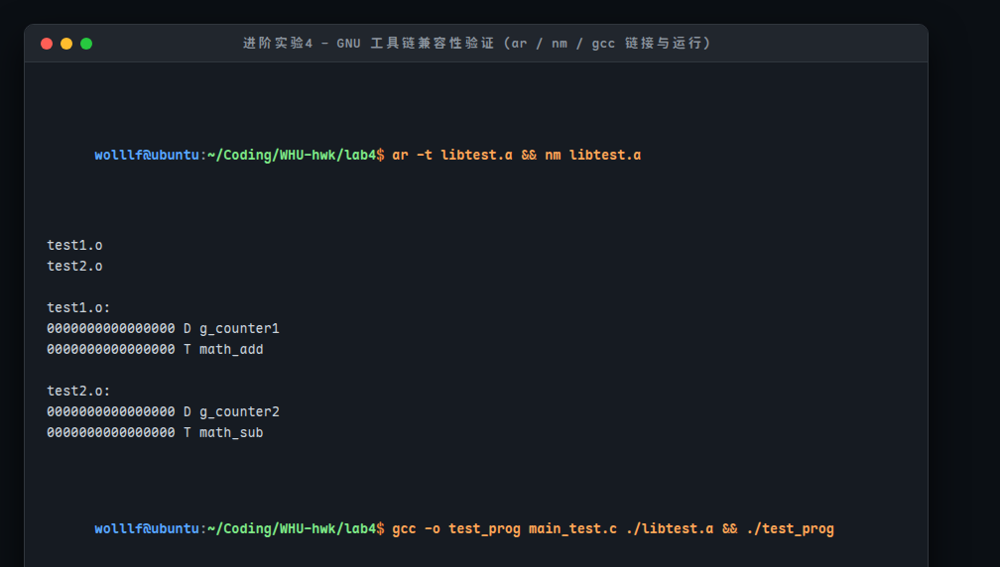

---

## 六、实验总结与心得体会

通过本次计算机系统导论“链接”实验，系统探索了编译系统底层的链接机制，收获了以下认识：
1. **理解 ELF 目标文件结构**：掌握了 `.text`, `.data`, `.bss`, `.symtab`, `.rela.text` 等关键节区在编译与链接中的角色，理解了符号解析如何匹配未定义符号（`'U'`）与全局定义符号（`'T'`/`'D'`）。
2. **掌握重定位的本质与计算细节**：通过手动推导与验算，掌握了 PC 相对寻址（`R_X86_64_PC32` / `R_X86_64_PLT32`）引入 `addend = -4` 以及减去 `refaddr` 的物理意义（因 PC 指针总是指向下一条指令的起始地址）；认识到了 PIE 与非 PIE 地址空间的布局差异。
3. **厘清静态链接与动态链接的应用场景**：验证了静态库的“按需链接”机制，理解了其为何能减小代码冗余；掌握了 `dlopen`/`dlsym` 的运行时动态加载原理，体会到现代软件插件架构与热更新的底层基石。
4. **进阶实现了简易打包工具 mylib**：通过直接解析 `/usr/include/elf.h` 与 `ar.h`，解析节头、符号表以及大端序索引构建，不仅加深了对二进制文件格式的理解，并通过了 GNU 官方工具的兼容测试，提升了系统级底层编程能力。
